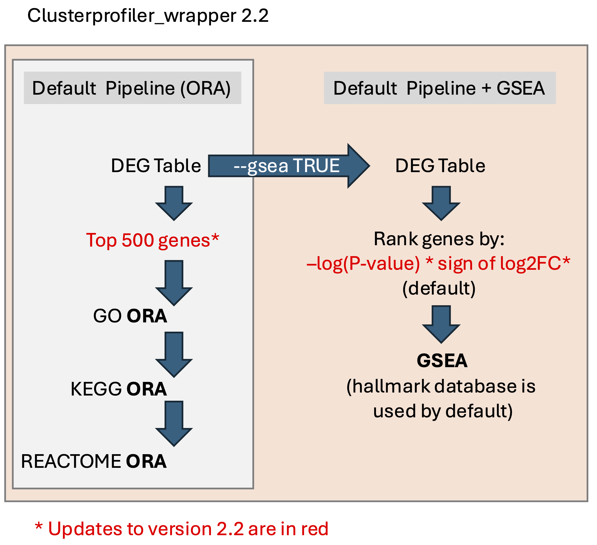

# ClusterProfiler Wrapper 2.2

The clusterprofiler wrapper is an R script that can be run from the commandline on the MSI. It uses the clusterprofiler R package functions under-the-hood to streamline pathway analysis (over-representation analysis and GSEA) when provided a bulk RNA-seq differential gene expression test results table.

For ORA, it will take the top 500 genes [can be adjusted] in the differential gene expression table and perform ORA against pathways in three databases: Gene Ontology (GO), Kyoto Encyclopedia of Genes and Genomes (KEGG), and REACTOME.   

For GSEA, it will rank all tested genes [ranks by -log10(PValue)x sign of fold change by default] and perform GSEA against the Hallmark database (default) from MSigDB (https://www.gsea-msigdb.org/gsea/msigdb). To perform GSEA using gene sets from other collections, see the `--msigdbs` option in the Options section.

### Required arguments:
The wrapper script requires three arguments to perform over-representation analysis (ORA) against pathways in three databases:
1) A differential gene expression results table produced by software such as edgeR or DESeq2. It requires a gene column, a log2 fold change column, a p-value column, and a FDR column. Tab-delimited text file.
2) The name (genus_species) of the organism the genes in the DEG table correspond to. The organism name must be in the format "Genus_species", where Genus is capitalized and species is lowercase (e.g. `Homo_sapiens`, `Mus_musculus`, `Canis_lupus_familiaris`).
3) Gene ID format. If the Gene ID is in gene symbol format, use `SYMBOL`. If ENSEMBL, use `ENSEMBL`. If Entrez, used `ENTREZID`.

Memory: at least 24GB

**Usage:**  

	run_clusterProfiler.R <DEG_table.tsv> <Genus_species> <GeneID_Format> [options]

**Important default settings for ORA:**   

The script will:   
1) subset the DEG table by FDR (default = 0.05, can change this value with `-p` option) and fold change (default = 1X, can change with `-c` option).  
2) use the top 500 genes *after* applying the above filters (default = 500 genes, can change the number of genes with `-g` option) for ORA against pathways from the GO, KEGG, and REACTOME databases. Default significance cutoffs for enriched pathway terms is P-value < 0.05 (can be modified with `-a` option).   
3) plot all significantly enriched pathway terms (can set number of terms to plot with "-n" option. It will plot most significant terms by FDR. Can set the significance threshold for ontology terms with `-a`).   

**ORA Output Files:**
1) **Parameter_settings.txt** : A text file with all of the parameters used for ORA and GSEA analysis. The settings in this file can be reported in papers.
2) **Table_[database]_enrichment_results.txt** : Tab-delimited text files of pathways enriched in each database. Note: if a database enrichment table is missing, there were no enriched pathways from that database.
3) **emapplot_[database]_allterms.pdf** : A network plot showing all of the significant pathway terms from a database and their relationships to each other. Nodes are pathways, and edges represent the number of genes shared between them. File is in PDF format.
4) **Dotplot_[database]_over_representation_allterms.pdf** :  A dotplot showing all significant pathway terms from a database, the fraction of genes annotated with a particular term in our query gene set, and the significance level.
5) **cnetplot_[database]_over_representation_allterms.pdf**: A network plot showing the significant pathway terms from a database and the genes that are associated with each pathway. It shows the fold change direction of the gene in the comparison.
6) **goplot_GO_allterms.pdf**: A plot of gene ontology pathway terms organized in a hierarchical fashion to show relationships between terms. It shows both significant and non-significant terms.
7) **[database]_enrichment_results.rds**: A R object in "RDS" format that can be loaded into R with the `readRDS` command. This R object can be filtered further and used with the `dotplot()`, `emapplot()`, `cnetplot` functions from the clusterprofiler R package.
--- 

### Gene Set Enrichment Analysis (GSEA):
To perform GSEA, include `--gsea TRUE` in the command. By default, all genes in the DEG table will be ranked by -log2(PValue)x sign of fold change. To change the ranking metric to -log(P-value) * the direction of the fold change, include `--prerankMethod pval` in the command.

#### Example command to run GSEA (ranking genes by log2FC)
	run_clusterProfiler.R <DEG_table.tsv> <Genus_species> <GeneID_Format> --gsea TRUE --prerankMethod lfc

#### Example command to run GSEA (ranking genes by -log(Pval)*FC direction):
	run_clusterProfiler.R <DEG_table.tsv> <Genus_species> <GeneID_Format> --gsea TRUE --prerankMethod pval

#### Example command to run GSEA (ranking genes by -log(Pval)*FC direction) against pathways in the HALLMARK, KEGG, GO, REACTOME databases:
	run_clusterProfiler.R <DEG_table.tsv> <Genus_species> <GeneID_Format> --gsea TRUE --prerankMethod pval --msigdbs h,c2_cp_kegg,c5_go_bp,c2_cp_reactome

**Important default settings for GSEA:**    
The GSEA code will:   
1) Rank genes by the metric selected. Default is log2FC. Can change this to rank by pvalue by including the `--prerankMethod pval` option.  
2) Perform GSEA against the Hallmark collection by default. Can change the database with the `--msigdbs` option. To run it against all databases, use `--msigdbs all` or provide a comma-separated list of databases (e.g. `--msigdbs h,c2_cp_kegg,c5_go_bp,c2_cp_reactome`) .
3) Generates GSEAplots, doplots, and GSEA tables of the results.

Note: This may not work well for organisms that are not human and mouse.

**GSEA Output:**    

GSEA will generate an output folder called `msigdb_gsea`. Contained within the `msigdb_gsea` folder are folders corresponding to each msigdb collection/database that was tested against. These folders contain GSEA plots for each enriched term that show the ranked gene list, the enrichment score, and the running sum statistic along the ranked list.
1) **Dotplot_GSEA_[collection/database].pdf** : A dotplot showing the enriched pathways from a collection/database, split by whether they are activated (positive enrichment score) or suppressed (negative enrichment score).
2) **msigdb_gsea.xlsx**: An excel file containing all of the enrichment results for each database.

--- 

### KEGG Pathview:
To make KEGG pathview plots from the KEGG ORA results, add `--keggpathview TRUE` to the command.

#### Example command to run ORA + KEGG pathview
	run_clusterProfiler.R Test_Data/Drosophila_melanogaster_edgeR_DEG_table.txt Drosophila_melanogaster SYMBOL --keggpathview TRUE

--- 

### ClusterProfiler wrapper options:

Usage: run_clusterProfiler.R [options] <DEG_file.txt> <species_name> <GeneID_format>

Options:

	-d CHARACTER, --dir=CHARACTER
		project directory. This will be created to output the clusterProfiler results.

	-n CHARACTER, --num_top_terms=CHARACTER
		Report top N ontology terms [default=all] in visualizations. [ORA option]

	-g CHARACTER, --numDEGs=CHARACTER
		Use top X DE genes for Ontology Term enrichment Analysis. Genes with p-value less than 0.05 (or user-specified cutoff) are sorted (largest to smallest) by the absolute value of log2FC. Top 500 genes are kept by default. [ORA option]

	-p CHARACTER, --FDRGenes=CHARACTER
		FDR cutoff used for classifying differentially expressed genes. [ORA option]

	-a CHARACTER, --pvalueOnt=CHARACTER
		p-value cutoff used for ontology term enrichment test. Default = 0.05 [ORA option]

	-c CHARACTER, --foldchange=CHARACTER
		absolute log2(fold change) cutoff for differentially expressed genes. Default is log2FC = 1. [ORA option]

	-b CHARACTER, --gene_ontology=CHARACTER
		Biological process (BP), Cellular Component (CC), Molecular function (MF), or all ontologies (ALL). Default is BP. [ORA option]

	--keggpathview=KEGGPATHVIEW
		Enable KEGG pathview plots for KEGG terms (TRUE/FALSE). [ORA option]

GSEA-specific options
	--gsea=GSEA
		Enable GSEA using msigdb (TRUE/FALSE). Default Molecular Signatures Database (msigdb) for GSEA = Hallmark (h). See --msigdbs option for other available databases. [GSEA 		option]

	--msigdbs=MSIGDBS
                Molecular Signatures Database (msigdb) for GSEA or comma-separated list of databases or use 'all' to run through all available databases for the species. Otherwise 			default database is hallmark (h). Available databases: c1, c2_cgp, c2_cp, c2_cp_biocarta, c2_cp_kegg, c2_cp_pid, c2_cp_reactome, c2_cp_wikipathways, c3_mir_mir_legacy, 		c3_mir_mirdb, c3_tft_gtrd, c3_tft_tft_legacy, c4_cgn, c4_cm, c5_go_bp, c5_go_cc, c5_go_mf, c5_hpo, c6, c7_immunesigdb, c7_vax, c8, h. For more information, see: 			http://www.gsea-msigdb.org/gsea/msigdb/index.jsp  [GSEA option]

        --prerankMethod=PRERANKMETHOD
                Method of ranking gene list for GSEA. 'pval' (default) will sort by -log10(pval) * (sign of fold change), and 'lfc' will sort by log2(fold change). Note: if P-value 			column is not provided, it will automatically sort by log2FC. Check the parameter_setting.txt file to check the method run. [GSEA option]

        --numPermutations=CHARACTER
                Number of times ranked genes are permutated for GSEA. At least 10k permutations are recommended. Default = 10,000. [GSEA option]

        --customGSEAgeneSet=CHARACTER
                A 2-column tab-delimited file containing a custom gene set to include alongside the gene sets specified by the --msigsdb option. column 1 should contain the name of the 		custom gene set. The header of this column should be 'database'. column 2 should contain the genes (in gene SYMBOL format) that are within the custom gene set. The header 		of column 2 should be set to 'gene'. [GSEA option]
		
	-h, --help
		Show this help message and exit

--- 
## clusterProfiler_wrapper version updates

v2.2
- New Feature: Custom gene sets can be provided for GSEA
- Default Parameter Change: Default for top genes for ORA has changed from 200 to 500.
- Default Parameter Change: Default ranking of genes for GSEA has changed from "lfc" (log2FC) and "pval" (log10PValue * sign of log2FC).
- Improvement on GSEA ranking: ranking by p-value ranks genes first by -log10(Pvalue), but if there are genes that are tied in rank, those genes will then be sorted by log2FC magnitude.
- Improvement on GSEA statistics: All msigdb collections (+ any custom gene sets) tested for GSEA are tested all together instead of separately.
- updated .libPaths() to MSI software R library folder

v2.1
- Fixed KEGG database issues (updated clusterprofiler R package)
- R package library location changed; new R packages were installed for R/4.3.0 (on Rocky Linux 8)
- Gene ranking in GSEA ranks by P-value instead of FDR when --prerankMethod=pval.
- Generates .RDS objects for all ORA results; these can be loaded into R and processed further with clusterProfiler R package

v2.0
- Added differential gene expression table screening functions
- Added try statements for GSEA function (fixes errors that result from odd DEG tables)
- Fixed enrichplot label issues
- Fixed KEGGenrich gene ID issues for Drosophila melanogaster

v1.6
- GSEA preranking method option is added

v1.5
- GOplot added for GO ORA 

v1.4
- runs GSEA (default GSEA disabled, default MsigDB = hallmark database)

v1.3
- Added option to enable/disable kegg pathview (default = FALSE)
- Writes out parameter file with all the clusterProfiler wrapper options used
- cnet and emap plot sizes scale better with number of terms

--- 

